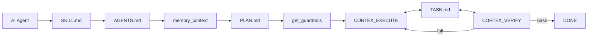

# Rencana & Teknologi — MCP "mcp-cortex-intelligent"

> Codename: **mcp-cortex-intelligent** (disingkat **Cortex**).
> Dokumen perencanaan FINAL, direkonstruksi ulang: detail, jelas, dan murni.
> Sifat: 100% offline, mandiri dari API key, mandiri dari servis luar.
> Tidak bergantung pada produk/servis eksternal apa pun.

---

## 1. Identitas Proyek

| Item | Nilai |
|---|---|
| Nama kode | mcp-cortex-intelligent |
| Jenis | MCP server (stdio, standar MCP) |
| Bahasa server | TypeScript (Node.js >= 22.12) |
| Penyimpanan | SQLite (`node:sqlite`) + FTS5 |
| Transport | stdio (official MCP SDK) |
| Klien target | OpenCode, Claude Desktop, Cursor, VS Code, lainnya |
| Sifat operasi | 100% offline, mandiri, deterministik |

**Tujuan inti**: membuat model LLM biasa menjadi "lebih pintar" melalui
MCP, dengan menambahkan konteks, prosedur, memori, contoh, verifikasi,
dan keputusan internal — bukan dengan mengganti model.

---

## 2. Tujuan & Manfaat

1. **Auto-provision Agent & Skill** di setiap sesi, idempotent (append, bukan timpa).
2. **Model awareness + guardrails**: prosedur anti-blunder yang disesuaikan
   dengan tier model yang terdeteksi.
3. **Cognitive augmentor offline**: exemplar, self-critique, compliance scoring,
   verification runner, internal decision engine.
4. **Memori jangka panjang**: fakta, keputusan, preferensi, instruksi persisten.
5. **Basis pengetahuan (knowledge base)**: ingest, chunk, embed, cari hybrid.
6. **Umpan balik eksekusi**: test/lint/typecheck nyata untuk perbaikan diri.

---

## 3. Ruang Lingkup

### 3.1 Dalam ruang lingkup

- MCP server stdio dengan ~58 tools.
- Auto-provision file `.opencode/agents` dan `.opencode/skills`.
- Deteksi model + profil tier + guardrails.
- Decision internal (heuristik) untuk tier/risk/route/compliance.
- Basis pengetahuan hybrid (BM25 + vector + RRF).
- Memori jangka panjang (decay, consolidate, importance).
- Verification runner (allowlist, sandbox, timeout).
- Self-critique terstruktur (checklist + scoring).
- Telemetri & status kognitif.

### 3.2 Luar ruang lingkup (sengaja)

- Tidak ada panggilan ke LLM eksternal.
- Tidak ada API key.
- Tidak ada servis cloud wajib.
- Tidak ada model gateway.
- Tidak ada integrasi produk pihak ketiga wajib.

---

## 4. Arsitektur

### 4.1 Diagram lapisan

```
+---------------------------------------------------------------+
|                    MCP Client (OpenCode, dll.)                |
|   model LLM biasa  --->  tools Cortex  --->  konteks/guardrail |
+-----------------------------+---------------------------------+
                              | stdio (MCP SDK)
+-----------------------------v---------------------------------+
|                Cortex MCP Server (100% offline)                |
|                                                               |
|  +----------------+  +----------------+  +------------------+  |
|  | Provisioner    |  | Model Guard    |  | Cognitive        |  |
|  | (agent/skill)  |  | (resolver,     |  | Augmentor        |  |
|  | marker-block   |  |  registry,     |  | (exemplar,       |  |
|  |                |  |  guardrails,   |  |  self-critique,  |  |
|  |                |  |  decision)     |  |  compliance,     |  |
|  |                |  |                |  |  verifier)       |  |
|  +-------+--------+  +-------+--------+  +--------+---------+  |
|          |                   |                    |            |
|  +-------v-------------------v--------------------v---------+  |
|  |              SQLite Store (node:sqlite) + FTS5            |  |
|  |  documents, chunks, chunks_fts, memories, meta            |  |
|  |  model_profiles, procedures, exemplars                    |  |
|  |  session_state, verification_runs, cognitive_scores       |  |
|  |  decisions, telemetry                                    |  |
|  +----------------------------------------------------------+  |
|  +----------------------------------------------------------+  |
|  |  Verification Runner (child_process, allowlist, sandbox)  |  |
|  +----------------------------------------------------------+  |
|  +----------------------------------------------------------+  |
|  |  Internal Decision Engine (heuristik/rules, deterministik)|  |
|  +----------------------------------------------------------+  |
+---------------------------------------------------------------+
```

### 4.2 Komponen utama

| Komponen | Tanggung jawab |
|---|---|
| Provisioner | Buat/append file agent & skill (marker-block idempotent) |
| Model Guard | Deteksi model, profil tier, guardrails, model decision |
| Cognitive Augmentor | Exemplar, self-critique, compliance, verifier |
| Knowledge Base | Ingest, chunk, embed, cari hybrid (BM25+vector+RRF) |
| Memory | Simpan/recall/consolidate memori jangka panjang |
| Session | Baca transcript sesi OpenCode |
| Decision Engine | Keputusan internal (tier, risk, route, compliance) |
| Telemetry | Catat event & status |

### 4.3 Prinsip desain

- **Offline-first**: semua fitur inti jalan mandiri jaringan.
- **Mandiri**: tidak ada API key, tidak ada servis wajib.
- **Idempotent**: provision & ingest aman dipanggil berulang.
- **Deterministik**: decision engine & scoring tidak acak.
- **Aman**: secrets tidak disimpan; verifier sandboxed.
- **Modular**: reuse modul internal, bukan dependensi eksternal wajib.

---

## 5. Komponen & Spesifikasi

### 5.1 Provisioner (marker-block, idempotent)

**Tujuan**: memastikan file agent & skill ada di setiap sesi. Jika sudah ada,
append blok auto (bukan timpa konten pengguna).

**Format marker**:
```
<!-- cortex:auto:begin v=<versi> sha=<sha256> -->
... konten auto ...
<!-- cortex:auto:end -->
```

**Algoritma `provision(filePath, autoBlock, version)`**:
1. Baca file jika ada.
2. Cari blok antara marker begin/end (regex).
3. Jika tidak ada blok → append blok di akhir file.
4. Jika ada blok → bandingkan sha256; jika berbeda, ganti hanya blok auto.
   Konten di luar marker tidak disentuh.
5. Simpan backup `.bak-<versi>` sebelum menulis (sekali per versi).
6. Catat `provisioned_version` di `session_state`.

**Sifat**: idempotent (panggil berkali-kali → hasil sama, tidak duplikat).

**Target file**:
- `.opencode/agents/cognitive-guardian.md`
- `.opencode/skills/cognitive-procedure/SKILL.md`

**Isi agent (auto block)**: instruksi untuk selalu memanggil `get_guardrails`,
mengikuti skill, dan sebelum final memanggil `self_critique` + `run_verification`.

**Isi skill (auto block)**: prosedur Plan → Read → Edit → Verify → Review,
checklist anti-blunder, kapan self-critique/exemplar/decision.

**Cuplikan kode** (`src/provisioner/marker-block.ts`):
```ts
const BEGIN = (v: string, sha: string) =>
  `<!-- cortex:auto:begin v=${v} sha=${sha} -->`;
const END = `<!-- cortex:auto:end -->`;

export function provision(filePath: string, autoBlock: string, version: string) {
  const sha = sha256(autoBlock);
  const block = `${BEGIN(version, sha)}\n${autoBlock}\n${END}`;
  let content = existsSync(filePath) ? readFileSync(filePath, "utf8") : "";
  const re = /<!-- cortex:auto:begin[\s\S]*?<!-- cortex:auto:end -->/;
  if (re.test(content)) {
    const m = content.match(re)!;
    if (sha256(m[0]) === sha) return { changed: false }; // idempotent
    content = content.replace(re, block);
  } else {
    content = content.trimEnd() + "\n\n" + block + "\n";
  }
  if (!existsSync(filePath + ".bak-" + version)) {
    writeFileSync(filePath + ".bak-" + version, originalContent);
  }
  mkdirSync(dirname(filePath), { recursive: true });
  writeFileSync(filePath, content);
  return { changed: true };
}
```

### 5.2 Model Awareness & Guardrails

**Model Resolver** (`src/model/resolver.ts`): deteksi model dari:
1. Argumen tool `model` eksplisit.
2. Env `CORTEX_MODEL`.
3. Env `OPENCODE_MODEL`.
4. File `opencode.json` di project root (field `model`).
5. Default `unknown`.

**Cuplikan kode**:
```ts
export function detectModel(opts: {
  arg?: string; env?: NodeJS.ProcessEnv; projectRoot?: string;
}) {
  if (opts.arg) return opts.arg;
  if (opts.env?.CORTEX_MODEL) return opts.env.CORTEX_MODEL;
  if (opts.env?.OPENCODE_MODEL) return opts.env.OPENCODE_MODEL;
  const cfg = readOpencodeConfig(opts.projectRoot);
  if (cfg?.model) return cfg.model;
  return "unknown";
}
```

**Tier classification (heuristik internal)**:
```ts
const WEAK = /haiku|mini|small|flash|8b|7b/i;
const STRONG = /opus|gpt-4o|sonnet-4|large|70b/i;
export function tierOf(model: string): "weak" | "medium" | "strong" {
  if (WEAK.test(model)) return "weak";
  if (STRONG.test(model)) return "strong";
  return "medium";
}
```

**Model Registry** (`src/model/registry.ts`): tabel `model_profiles` berisi
tier, capability flags, blunder_patterns. Diisi manual atau dari basis pengetahuan.

**Guardrails Generator** (`src/model/guardrails.ts`): berdasarkan tier + task type,
hasilkan markdown checklist siap-injeksi:
- Model terdeteksi & tier.
- Prosedur wajib (numbered).
- Anti-blunder (jangan lakukan X).
- Verifikasi (test/lint/build).

Weak → langkah granular + forced read-before-edit + verify wajib.

**Model Decision (internal)** (`src/model/model-decision.ts`):
```ts
export function modelDecision(model: string, task: string, files: string[]) {
  const tier = tierOf(model);
  const risk = taskRisk(task, files); // low/medium/high by heuristik
  const needsVerify = risk !== "low" || tier === "weak";
  const route = procedureRoute(task); // code_edit/refactor/debug/plan/docs
  return { tier, risk, needsVerify, route, rationale: "rule-based" };
}
```

### 5.3 Cognitive Augmentor (offline)

**Self-Critique** (`src/cognitive/self-critique.ts`):
```ts
export function selfCritique(artifact: string) {
  const checks = [
    { name: "has_tests", pass: /test|spec/i.test(artifact) },
    { name: "read_before_edit", pass: /read/i.test(artifact) },
    { name: "no_secrets", pass: !/(api[_-]?key|token|password)/i.test(artifact) },
    { name: "has_verification", pass: /npm (test|run lint|run typecheck)/i.test(artifact) },
  ];
  const score = checks.filter(c => c.pass).length / checks.length;
  const issues = checks.filter(c => !c.pass).map(c => `Missing: ${c.name}`);
  return { score, issues, suggestions: issues.map(i => `Add ${i}`) };
}
```

**Compliance** (`src/cognitive/compliance.ts`): cek apakah langkah wajib dari
guardrails ada di plan/diff. Return `{ score, missing_steps }`.

**Verifier** (`src/cognitive/verifier.ts`):
```ts
export function runVerification(cmds: string[], cwd: string, timeoutMs: number) {
  return cmds.map(cmd => {
    const r = spawnSync(cmd, { shell: true, cwd, timeout: timeoutMs, encoding: "utf8" });
    return { cmd, exitCode: r.status ?? 1, summary: (r.stdout + r.stderr).slice(0, 2000), passed: r.status === 0 };
  });
}
```
Allowlist dari env `CORTEX_VERIFY_ALLOWLIST`.

**Exemplars** (`src/cognitive/exemplars.ts`): simpan/ambil contoh berkualitas
via basis pengetahuan (tag `exemplar`).

### 5.4 Internal Decision Engine

`src/decision/internal.ts`:
```ts
export function decisionClassify(input: { state: string; questions: any }) {
  // rules/heuristik internal, deterministik, mandiri
  // contoh: klasifikasi risk, tier, route
  return { answers: {}, rationale: "rule-based", latencyMs: 0 };
}
```

Fungsi: keputusan cepat & deterministik (tier, risk, route, compliance)
berbasis rules/heuristik internal, mandiri API.

### 5.5 Basis Pengetahuan (Knowledge Base)

Modul internal: embedder, chunker, vector-search, pipeline.
- Ingest text/file/directory.
- Chunking blok teks/code-aware dengan overlap.
- Embedding: local hashing (default, offline) atau transformers (opsional).- Pencarian hybrid: BM25 (FTS5 trigram) + cosine vector + RRF.
- Dedup via content-hash (SHA-256).
- Guard file size & path allowlist.

### 5.6 Memori Jangka Panjang

- `memory_remember/recall/context/list/get/update/forget/consolidate/stats`.
- Tipe: fact, preference, decision, instruction, task, insight, conversation.
- Decay by staleness (half-life configurable).
- Consolidate duplicates (cosine + word overlap).
- **Aturan**: tidak menyimpan secret/token/password (plaintext store).

### 5.7 Sesi (Transcript)

- Baca sesi OpenCode dari DB (global + local).
- Ingest user inputs sebagai dokumen (source: opencode-db).
- Kondensasi input panjang (extractive, mandiri LLM).
- Idempotent via content-hash.

---

## 6. Skema Data (SQLite)

### 6.1 Tabel inti (reuse)

- `documents`, `chunks`, `chunks_fts`, `memories`, `meta`.

### 6.2 Tabel baru

```sql
model_profiles(
  id TEXT PRIMARY KEY,
  provider TEXT,
  model TEXT,
  tier TEXT,
  capabilities TEXT,        -- JSON
  blunder_patterns TEXT,    -- JSON
  updated_at INTEGER
);

procedures(
  id TEXT PRIMARY KEY,
  name TEXT,
  version TEXT,
  content TEXT,
  tags TEXT,                -- JSON
  source TEXT,
  created_at INTEGER,
  updated_at INTEGER
);

exemplars(
  id TEXT PRIMARY KEY,
  task_type TEXT,
  language TEXT,
  title TEXT,
  content TEXT,
  outcome TEXT,
  score REAL,
  tags TEXT,                -- JSON
  created_at INTEGER
);

session_state(
  session_id TEXT PRIMARY KEY,
  project_root TEXT,
  model TEXT,
  tier TEXT,
  provisioned_version TEXT,
  last_bootstrap INTEGER,
  cognitive_calls INTEGER,
  verification_runs INTEGER,
  decision_calls INTEGER
);

verification_runs(
  id INTEGER PRIMARY KEY AUTOINCREMENT,
  ts INTEGER,
  session_id TEXT,
  command TEXT,
  exit_code INTEGER,
  summary TEXT,
  passed INTEGER
);

cognitive_scores(
  id INTEGER PRIMARY KEY AUTOINCREMENT,
  ts INTEGER,
  session_id TEXT,
  kind TEXT,
  score REAL,
  details TEXT              -- JSON
);

decisions(
  id INTEGER PRIMARY KEY AUTOINCREMENT,
  ts INTEGER,
  session_id TEXT,
  kind TEXT,
  input TEXT,
  output TEXT,              -- JSON
  rationale TEXT
);

telemetry(
  id INTEGER PRIMARY KEY AUTOINCREMENT,
  ts INTEGER,
  event TEXT,
  session_id TEXT,
  model TEXT,
  payload TEXT              -- JSON
);

tasks(
  id TEXT PRIMARY KEY,
  plan_ref TEXT,
  title TEXT NOT NULL,
  status TEXT NOT NULL,     -- todo | doing | done | blocked
  priority INTEGER DEFAULT 0,
  owner TEXT,
  notes TEXT,
  created_at INTEGER,
  updated_at INTEGER,
  done_at INTEGER
);
```

---

## 7. Daftar Tools (45)

### 7.1 System

| Tool | Tujuan |
|---|---|
| `system_stats` | DB, embedding, counts, verifier status |
| `cognitive_status` | Ringkasan sesi: model, tier, calls, scores, verifikasi, decision |

### 7.2 Provisioning

| Tool | Tujuan |
|---|---|
| `bootstrap_session` | Deteksi root, provision agent+skill, catat session_state |
| `provision_agent_skill` | Provision/append manual (force version) |
| `list_agents_skills` | Inventaris file agent/skill + versi blok |
| `update_procedure_block` | Update blok auto dengan versi baru |

### 7.3 Model

| Tool | Tujuan |
|---|---|
| `detect_model` | Deteksi model dari env/config/param |
| `get_model_profile` | Profil & tier model |
| `set_model` | Override model untuk sesi |
| `get_guardrails` | Prosedur + anti-blunder + verifikasi (siap injeksi) |
| `model_decision` | Klasifikasi tier/risk/route via decision internal |

### 7.4 Procedure / Knowledge

| Tool | Tujuan |
|---|---|
| `get_procedure` | Ambil prosedur by name/task |
| `list_procedures` | Daftar prosedur |
| `ingest_procedure` | Simpan prosedur baru |
| `retrieve_exemplars` | Ambil contoh terbaik untuk task |
| `ingest_exemplar` | Simpan contoh berkualitas tinggi |
| `knowledge_ingest_text` | Ingest teks |
| `knowledge_ingest_file` | Ingest file |
| `knowledge_ingest_dir` | Ingest direktori |
| `knowledge_search` | Pencarian hybrid |
| `knowledge_retrieve` | Blok konteks siap-injeksi |
| `knowledge_list_documents` | Daftar dokumen |
| `knowledge_document_stats` | Statistik dokumen |
| `knowledge_delete_document` | Hapus dokumen |
| `knowledge_sync_session` | Ingest sesi OpenCode |
| `knowledge_reindex` | Re-embed semua vektor |
| `knowledge_backup` | Snapshot SQLite |

### 7.5 Memory

| Tool | Tujuan |
|---|---|
| `memory_remember` | Simpan memori |
| `memory_recall` | Cari memori semantik |
| `memory_context` | Blok konteks dari memori |
| `memory_list` | Daftar memori |
| `memory_get` | Ambil memori by id |
| `memory_update` | Update memori |
| `memory_forget` | Hapus memori |
| `memory_consolidate` | Dedup + promote hot |
| `memory_stats` | Statistik memori |

### 7.6 Cognitive (offline)

| Tool | Tujuan |
|---|---|
| `self_critique` | Checklist + scoring + issues (mandiri LLM) |
| `score_compliance` | Cek kelengkapan langkah wajib |
| `run_verification` | Jalankan test/lint/typecheck allowlist |

### 7.7 Decision (internal)

| Tool | Tujuan |
|---|---|
| `decision_classify` | Keputusan internal (tier/risk/route/compliance) |
| `decision_health` | Status decision engine internal |

### 7.8 Plan & Task Management

| Tool | Tujuan |
|---|---|
| `init_plan` | Buat PLAN.md skeleton jika belum ada |
| `read_plan` | Baca PLAN.md |
| `update_plan_section` | Update section PLAN.md by heading |
| `init_task` | Buat TASK.md skeleton jika belum ada |
| `task_create` | Buat task baru |
| `task_list` | Daftar task (filter status/priority) |
| `task_get` | Detail task by id |
| `task_start` | Set status doing |
| `task_done` | Set status done |
| `task_block` | Set status blocked + reason |
| `task_delete` | Hapus task |
| `task_sync_md` | Tulis TASK.md dari DB |
| `task_summary` | Ringkasan status task |

---

## 8. Alur Kerja

### 8.1 Bootstrap Sesi

1. Plugin/awal sesi panggil `bootstrap_session(project_root)`.
2. Deteksi model → `model_decision` (internal) → set `session_state`.
3. Provision agent+skill (append jika ada).
4. Injeksi instruksi: `memory_context` + `get_guardrails(task="session_start")`.
5. Catat telemetry `bootstrap`.

### 8.2 Eksekusi Tugas (anti-blunder)

1. Model panggil `get_guardrails(task_type)` → dapat checklist.
2. `retrieve_exemplars(task)` → contoh langkah terbaik.
3. `model_decision` → tier/risk/route (keputusan internal).
4. Ikuti langkah: Plan → Read → Edit → Verify → Review.
5. Sebelum edit file, wajib `read` (guardrail).
6. Setelah edit, `run_verification()` → feedback nyata.
7. `score_compliance(plan)` → pastikan langkah wajib ada.
8. `self_critique(artifact)` → revisi sampai score ≥ threshold.

### 8.3 "Model Lebih Pintar" (offline, internal)

1. Model buat draft (plan/kode).
2. `retrieve_exemplars` → bandingkan dengan contoh terbaik.
3. `decision_classify` → apakah draft berisiko / perlu revisi.
4. `self_critique(draft)` → issues + score.
5. Jika score < threshold → revisi dengan issues → ulang (max N).
6. `run_verification()` → konfirmasi pass/fail nyata.

---

### 8.4 Plan & Task Loop

1. `memory_context` → konteks memori.
2. `get_guardrails` → checklist anti-blunder.
3. `init_plan` + `init_task`.
4. Agent baca PLAN.md → tentukan task berikutnya.
5. `task_list(status="todo")` → pilih task.
6. `task_start(id)` → doing.
7. `CORTEX_EXECUTE` (kerjakan dengan guardrails + verification).
8. `CORTEX_VERIFY` → lulus → `task_done(id)`; gagal → `task_block(id, reason)` / revisi.
9. `task_sync_md()` → tulis TASK.md.
10. Ulangi sampai semua done.

## 9. Konfigurasi (Env)

| Var | Default | Tujuan |
|---|---|---|
| `CORTEX_DB_DIR` | `.cortex-data` | Lokasi SQLite |
| `CORTEX_MODEL` | (auto) | Override model |
| `CORTEX_TIER_OVERRIDE` | (auto) | Override tier |
| `CORTEX_VERIFY_ALLOWLIST` | `npm test,npm run lint,npm run typecheck` | Perintah verifikasi |
| `CORTEX_VERIFY_TIMEOUT_MS` | `300000` | Timeout verifikasi |
| `CORTEX_VERIFY_CWD` | (project root) | Cwd verifikasi |
| `CORTEX_SELF_CRITIQUE_THRESHOLD` | `0.8` | Threshold revisi |
| `CORTEX_SELF_CRITIQUE_MAX_ITERS` | `3` | Max iterasi self-critique |
| `CORTEX_PROVISION_BACKUP` | `1` | Backup sebelum tulis |
| `CORTEX_GUARDRAILS_STRICT` | `1` | Wajibkan guardrails |
| `EMBEDDING_PROVIDER` | `local` | local / transformers |
| `EMBEDDING_MODEL` | `Xenova/all-MiniLM-L6-v2` | Model embedding |
| `SEARCH_MODE` | `hybrid` | hybrid / vector / keyword |
| `KB_MEMORY_HALF_LIFE_DAYS` | `14` | Half-life decay memori |

Aturan: `.env` hanya boleh set var `CORTEX_*`, `KB_*`, `OPENCODE_*`,
`EMBEDDING_*`, `SEARCH_MODE`. Yang lain diabaikan + warning.
Mandiri: API key, servis luar. Semua internal.

---

## 10. Keamanan

- Secrets tidak disimpan (no-secret rule): token/key/password tidak masuk DB/memori.
- Verification runner: allowlist, cwd terkunci, timeout, env minimal (mandiri secret).
- Provisioning: path allowlist `.opencode/`, backup sebelum tulis, idempotent.
- 100% offline, tidak ada panggilan jaringan.
- Redact secret sebelum log/telemetry.

---

## 11. Struktur Repo

```
D:/path/to/mcp-cortex-intelligent/
  PLAN.md, README.md, package.json, tsconfig*.json, .env.example
  src/
    index.ts, env.ts
    mcp/cortex-server.ts
    db/database.ts
    knowledge/          (embedder, embeddings, chunker, vector-search, pipeline)
    memory/             (memory logic)
    session/            (transcript)
    provisioner/        (marker-block, agent-generator, skill-generator)
    model/              (resolver, registry, guardrails, model-decision)
    cognitive/          (exemplars, self-critique, compliance, verifier)
    decision/           (internal)
    procedures/         (library)
    test/               (test-all)
  .opencode/
    instructions.md
     agents/ (cognitive-guardian.md)
     skills/ (cognitive-procedure/SKILL.md)
     plugins/ (cortex-auto/index.ts)
  docs/
```

Strategi: modul internal, mandiri. Tidak bergantung pada paket eksternal wajib
selain MCP SDK, zod, node:sqlite.

---

## 12. Roadmap (Fase)

- **F0**: Plan & scaffold (dokumen ini) — selesai (plan).
- **F1**: Core MCP + Knowledge/Memory (setup server, DB, reuse modul, test round-trip).
- **F2**: Provisioner (marker-block, agent/skill generator, bootstrap).
- **F3**: Model Awareness & Guardrails + Model Decision (resolver, registry, guardrails, model_decision).
- **F4**: Cognitive Augmentor (exemplars, self_critique, score_compliance, run_verification).
- **F5**: Internal Decision Engine (decision_classify, decision_health, rules).
- **F6**: Procedures Library + Telemetry + Polish (ingest procedure, cognitive_status, docs, lint/typecheck/test hijau).
- **F7**: Plan & Task Management (init_plan, init_task, task_*, sync TASK.md, integrasi guardrails).

Setiap fase diakhiri: `npm test`, `npm run lint`, `npm run typecheck` hijau, plus commit.

---

## 13. Risiko & Mitigasi

| Risiko | Mitigasi |
|---|---|
| Provisioning timpa konten pengguna | Marker-block, backup, idempotent |
| Self-critique lemah vs LLM | Exemplar + verifier + internal decision |
| Internal decision lemah | Akumulasi data historis + rules yang dapat diperbarui |
| Verifier disalahgunakan | Allowlist, cwd terkunci, timeout, env minimal |
| Model detection salah | Override env + set_model + model_decision |
| Secret bocor | no-secret rule + redact |
| Blunder tetap terjadi | Guardrails + self-critique + decision + verify |
| Kompleksitas | Fase bertahap, modul internal mandiri |

---

## 14. Kriteria Selesai (Definition of Done)

- [ ] Semua ~45 tools terdaftar dan lolos round-trip test.
- [ ] `npm test`, `npm run lint`, `npm run typecheck` hijau.
- [ ] Bootstrap sesi menghasilkan agent & skill (idempotent, tidak timpa konten user).
- [ ] Guardrails terinjeksi sesuai tier model.
- [ ] Self-critique + compliance + verifier berjalan offline.
- [ ] Decision internal menghasilkan tier/risk/route/compliance.
- [ ] Tidak ada API key / servis wajib.
- [ ] Plan & Task management berfungsi (init, create, start, done, block, sync).
- [ ] Dokumentasi (README) & .env.example sinkron.

---

## 16. Penanganan Error & Resiliensi

- **DB lock/busy**: gunakan `busy_timeout` (default 5000ms), retry 3x dengan backoff.
- **Embedding mismatch**: `ensureDim` menolak pencampuran ruang vektor; arahkan
  ke `knowledge_reindex` atau DB baru.
- **File I/O gagal**: kembalikan error terstruktur `{ ok:false, error, hint }`,
  jangan crash server.
- **Verifier timeout**: kill child process, catat `exit_code=-1`, `passed=false`.
- **Decision engine**: jika rules gagal, fallback ke heuristic minimal & log.
- **Plugin gagal**: tidak memblokir MCP; server tetap jalan.
- **Graceful shutdown**: flush telemetry, close DB handle.

## 17. Logging & Observabilitas

- Log ke stderr (stdout dicadangkan untuk MCP protocol).
- Level: `error`, `warn`, `info`, `debug` via env `CORTEX_LOG_LEVEL`.
- Setiap tool call: log nama tool, durasi, status (mandiri payload sensitif).
- `system_stats` & `cognitive_status` mengekspos ringkasan.
- Telemetry tabel untuk analisis jangka panjang.

## 18. Plugin Bootstrap (OpenCode)

     agents/ (cognitive-guardian.md)
     skills/ (cognitive-procedure/SKILL.md)
     plugins/ (cortex-auto/index.ts)

## 19. Validasi Konfigurasi

- Loader `.env` hanya menerima var yang diizinkan (`CORTEX_*`, `KB_*`,
  `OPENCODE_*`, `EMBEDDING_*`, `SEARCH_MODE`).
- Var lain diabaikan + warning ke stderr.
- Env var asli (shell) selalu menang atas file.
- Validasi tipe & range (zod) saat boot; gagal → pesan jelas + exit code 1.

## 20. Strategi Pengujian (Detail)

- **Unit**: marker-block idempotency, tierOf, selfCritique scoring, compliance,
  decisionClassify deterministik.
- **Integration**: DB CRUD, ingest/search/retrieve round-trip, memory decay.
- **MCP round-trip**: SDK client spawn server, panggil semua tools, verifikasi
  schema & output.
- **Provisioning test**: buat file, append, re-run, verifikasi tidak duplikat &
  konten user utuh.
- **Verifier test**: command sukses/gagal/timeout.
- **Golden test**: guardrails output untuk tiap tier & task type.
- Target cakupan: >= 80% modul inti.
## 21. Performa & Batasan

- Pencarian brute-force O(N) per query (exact, deterministik).
- Vector cache di RAM (uncapped). Warning jika > `KB_VECTOR_CACHE_WARN_MB`.
- Chunking & ingest async; batch embedding configurable.
- Verifier timeout default 300s.
- Self-critique max iterasi default 3.
- Decision engine O(1) (rules).
- Skala target: ribuan chunk (personal store).

## 22. Versioning & Migrasi

- Versi server di `package.json` + marker-block version.
- Marker-block version naik → re-provision otomatis (append/replace auto block).
- Embedding model berubah → `knowledge_reindex` (migrasi in-place).
- DB schema migration: skrip `migrate` idempotent saat boot.
- Backup sebelum migrasi (`knowledge_backup`).

## 23. Contoh Output

### 23.1 Guardrails (tier weak, task code_edit)

```
Model: claude-haiku (tier: weak)
Prosedur wajib:
1. Baca file target sebelum edit.
2. Buat rencana singkat.
3. Edit minimal.
4. Jalankan test & lint.
5. Review diff.
Anti-blunder:
- Jangan asumsikan path ada.
- Jangan edit mandiri baca.
- Jangan skip verifikasi.
Verifikasi: npm test, npm run lint, npm run typecheck
```

### 23.2 Self-Critique

```
score: 0.5
issues: ["Missing: has_tests", "Missing: has_verification"]
suggestions: ["Add has_tests", "Add has_verification"]
```

## 24. Glosarium

- **Agent**: persona/role di OpenCode (file `.opencode/agents/*.md`).
- **Skill**: prosedur reusable (`.opencode/skills/*/SKILL.md`).
- **Guardrails**: checklist prosedur anti-blunder.
- **Exemplar**: contoh berkualitas tinggi (gold example).
- **Self-critique**: evaluasi mandiri terstruktur.
- **Compliance**: kelengkapan langkah wajib.
- **Decision internal**: keputusan berbasis rules (tier/risk/route).
- **Marker-block**: blok auto dengan marker begin/end untuk append idempotent.

## 25. Pertanyaan Terbuka

1. Apakah 45 tools terlalu banyak? (kandidat pemangkasan: gabung memory_*.)
2. Apakah tier classification heuristik cukup, atau perlu data historis?
3. Apakah self-critique perlu kriteria tambahan per bahasa (TS/Python/etc.)?
4. Apakah verification runner perlu sandbox lebih ketat (container)?

## 26. Plan & Task Management (AI Agent → SKILL.md → AGENTS.md → PLAN.md ↔ CORTEX_EXECUTE ↔ TASK.md ↔ CORTEX_VERIFY → DONE)

### 26.1 Konsep

Model menjadi "lebih pintar" tidak hanya dari konteks/prosedur, tetapi dari
**pelacakan pekerjaan**: apa yang sudah dikerjakan vs belum. Siklus:



MCP menginisialisasi & mengelola `PLAN.md` dan `TASK.md` agar model selalu tahu
status pekerjaan, menghindari pengulangan/blunder.

### 26.2 File yang Dikelola

- `PLAN.md` — rencana (sudah ada). MCP dapat init jika belum ada.
- `TASK.md` — daftar tugas dengan status (todo/doing/done/blocked).
- Marker-block idempotent juga dipakai untuk blok auto di kedua file.

### 26.3 Skema Task (SQLite + Markdown)

Tabel `tasks`:
```sql
tasks(
  id TEXT PRIMARY KEY,
  plan_ref TEXT,        -- referensi ke section PLAN.md
  title TEXT NOT NULL,
  status TEXT NOT NULL, -- todo | doing | done | blocked
  priority INTEGER DEFAULT 0,
  owner TEXT,
  notes TEXT,
  created_at INTEGER,
  updated_at INTEGER,
  done_at INTEGER
)
```

Sinkronisasi dua arah: DB (sumber kebenaran) ↔ TASK.md (human-readable).
MCP menyediakan tool untuk baca/tulis kedua sisi.

### 26.4 Alur Kerja

1. Bootstrap sesi → `init_plan` (jika PLAN.md belum ada, buat skeleton).
2. `init_task` (jika TASK.md belum ada, buat skeleton).
3. Agent baca PLAN.md → tentukan task berikutnya.
4. `task_list(status="todo")` → pilih task.
5. `task_start(id)` → status doing.
6. Kerjakan (EXECUTE) dengan guardrails + verification.
7. `task_done(id)` → status done, catat done_at.
8. Jika gagal → `task_block(id, reason)`.
9. `task_sync_md()` → tulis TASK.md dari DB.
10. Ulangi sampai semua task done.

### 26.5 Tools Baru (Plan & Task)

| Tool | Tujuan |
|---|---|
| `init_plan` | Buat PLAN.md skeleton jika belum ada (idempotent) |
| `read_plan` | Baca PLAN.md (ringkas/utuh) |
| `update_plan_section` | Update section PLAN.md by heading |
| `init_task` | Buat TASK.md skeleton jika belum ada |
| `task_create` | Buat task baru (title, plan_ref, priority) |
| `task_list` | Daftar task (filter status/priority) |
| `task_get` | Detail task by id |
| `task_start` | Set status doing |
| `task_done` | Set status done (catat done_at) |
| `task_block` | Set status blocked + reason |
| `task_delete` | Hapus task |
| `task_sync_md` | Tulis TASK.md dari DB |
| `task_summary` | Ringkasan: total/todo/doing/done/blocked |

### 26.6 Integrasi dengan Guardrails

`get_guardrails` menambahkan instruksi:
- "Cek task_list(status=todo) sebelum mulai."
- "Tandai task_done setelah verifikasi lulus."
- "Jangan mulai task baru sebelum task sebelumnya done."

### 26.7 Manfaat untuk Model "Lebih Pintar"

- Model tidak mengulang pekerjaan yang sudah done.
- Model tahu mana yang blocked dan alasannya.
- Plan/TASK menjadi memori eksternal yang persisten antar sesi.
- Mengurangi blunder karena status pekerjaan eksplisit.

---

## 15. Langkah Berikutnya

1. Konfirmasi scope & nama (mcp-cortex-intelligent).
2. Putuskan mode modul internal (copy vs npm internal).
3. Mulai Fase 1 (scaffold + core MCP).

> Detail implementasi tiap modul dilengkapi saat eksekusi fase.
