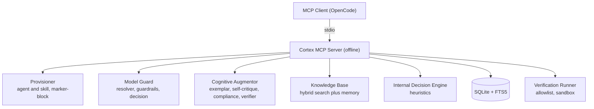
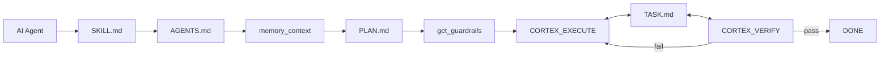

# mcp-cortex-intelligent — Cortex Intelligent

<p align="center">
  
</p>

[](https://github.com/adyoi/mcp-cortex-intelligent/actions/workflows/ci.yml)
[](https://www.npmjs.com/package/mcp-cortex-intelligent)
[](LICENSE)
[](https://nodejs.org)

Make ordinary LLMs smarter — offline, no API keys, no external services.

MCP server that augments an ordinary LLM with context, procedures, memory, exemplars, verification, and an internal decision engine. Standard MCP (stdio), compatible with OpenCode, Claude Desktop, Cursor, VS Code, and any MCP client.

## Architecture



## Features

- **Auto-Provision Agent & Skill** — idempotent marker-block append, never overwrites user content, backup before write.
- **Model Awareness + Guardrails** — detects model tier (weak/medium/strong), injects anti-blunder procedures.
- **Offline Cognitive Augmentor** — exemplar retrieval, structured self-critique, compliance scoring, verification runner.
- **Internal Decision Engine** — fast deterministic decisions (tier/risk/route/compliance) via heuristics. No LLM.
- **Plan & Task Management** — AI Agent → SKILL.md → AGENTS.md → PLAN.md ↔ CORTEX_EXECUTE ↔ TASK.md ↔ CORTEX_VERIFY → DONE. Persistent task tracking.
- **Knowledge Base + Memory** — hybrid search (BM25 + vector + RRF), long-term memory with decay.

## Installation

### Requirements
- Node.js >= 22.12 (for node:sqlite)
- npm

### From source
```bash
git clone https://github.com/adyoi/mcp-cortex-intelligent.git
cd mcp-cortex-intelligent
npm install
npm run build
npm start
```

### From npm (after publish)
```bash
npx mcp-cortex-intelligent
```

## Configuration

Copy `.env.example` to `.env` and edit. Environment variables always win over the file.

| Variable | Default | Purpose |
|---|---|---|
| CORTEX_DB_DIR | .cortex-data | SQLite store location |
| CORTEX_MODEL | (auto) | Override model |
| CORTEX_TIER_OVERRIDE | (auto) | Override tier |
| CORTEX_VERIFY_ALLOWLIST | npm test,npm run lint,npm run typecheck | Verification commands |
| CORTEX_VERIFY_TIMEOUT_MS | 300000 | Verification timeout |
| CORTEX_VERIFY_CWD | (project root) | Working directory for verification |
| CORTEX_LOG_LEVEL | info | Log level (error/warn/info/debug) |
| CORTEX_SELF_CRITIQUE_THRESHOLD | 0.8 | Revision threshold |
| CORTEX_SELF_CRITIQUE_MAX_ITERS | 3 | Max self-critique iterations |
| CORTEX_PROVISION_BACKUP | 1 | Backup before write |
| CORTEX_GUARDRAILS_STRICT | 1 | Enforce guardrails |
| EMBEDDING_PROVIDER | local | local / transformers |
| EMBEDDING_MODEL | Xenova/all-MiniLM-L6-v2 | Embedding model |
| SEARCH_MODE | hybrid | hybrid / vector / keyword |
| KB_MEMORY_HALF_LIFE_DAYS | 14 | Memory decay half-life |
| KB_PRUNE | 0 | Prune stale memories on consolidate |
| KB_VECTOR_CACHE_WARN_MB | 256 | Vector cache warning threshold (MB) |
| KB_SESSION_MAX_MSGS | 500 | Max session messages ingested |

### OpenCode registration

Add to `~/.config/opencode/opencode.json`:

```json
{
  "mcp": {
    "cortex": {
      "type": "local",
      "command": ["node", "~/mcp-cortex-intelligent/dist/index.js"],
      "cwd": "~/mcp-cortex-intelligent",
      "environment": { "CORTEX_DB_DIR": "~/mcp-cortex-intelligent/.cortex-data" }
    }
  }
}
```

## Tools (62)

| Group | Count | Tools |
|---|---|---|
| System | 3 | system_stats, lsp_diagnostics, cognitive_status |
| Provisioning | 4 | bootstrap_session, provision_agent_skill, list_agents_skills, update_procedure_block |
| Model | 5 | detect_model, get_model_profile, set_model, get_guardrails, model_decision |
| Knowledge | 11 | knowledge_ingest_text, knowledge_ingest_file, knowledge_ingest_dir, knowledge_search, knowledge_retrieve, knowledge_list_documents, knowledge_document_stats, knowledge_delete_document, knowledge_sync_session, knowledge_reindex, knowledge_backup |
| Memory | 9 | memory_remember, memory_recall, memory_context, memory_list, memory_get, memory_update, memory_forget, memory_consolidate, memory_stats |
| Cognitive | 3 | self_critique, score_compliance, run_verification |
| Decision | 2 | decision_classify, decision_health |
| Procedure | 5 | get_procedure, list_procedures, ingest_procedure, retrieve_exemplars, ingest_exemplar |
| Plan & Task | 17 | init_plan, read_plan, update_plan_section, init_task, init_agents, init_audit, task_create, task_list, task_get, task_start, task_done, task_block, task_delete, task_update, task_sync_md, task_summary, task_from_plan |
| Web | 3 | webfetch, webfetch_validate, browser_fetch |

## Workflow

### Bootstrap Session
1. Call `bootstrap_session(project_root)`.
2. Detect model → `model_decision` → set session state.
3. Provision agent & skill (append if exists).
4. Inject guardrails via `get_guardrails(task="session_start")`.

### Task Execution
1. `get_guardrails(task_type)` → checklist.
2. `retrieve_exemplars(task)` → best examples.
3. Plan → Read → Edit → Verify → Review.
4. `run_verification()` → real feedback.
5. `score_compliance(plan)` + `self_critique(artifact)`.

### Plan & Task Loop



### Steps
1. `init_plan` + `init_task`.
2. Agent reads PLAN.md → picks next task.
3. `task_list(status="todo")` → choose.
4. `task_start(id)` → doing.
5. Execute with guardrails + verification.
6. `task_done(id)` after verification passes.
7. `task_sync_md()` → write TASK.md.

## Security

- Secrets are never stored (no-secret rule).
- Verification runner uses allowlist, locked cwd, timeout, minimal env.
- Provisioning restricted to `.opencode/` under project root.
- Backup before overwrite; idempotent writes.
- 100% offline, no network calls.

## Development

```bash
npm install
npm run typecheck
npm run lint
npm run build
npm test
npm start
```

## Documentation

Full documentation: https://adyoi.github.io/mcp-cortex-intelligent/

## Contributing

See [CONTRIBUTING.md](CONTRIBUTING.md) and [SECURITY.md](SECURITY.md).

## License

MIT
